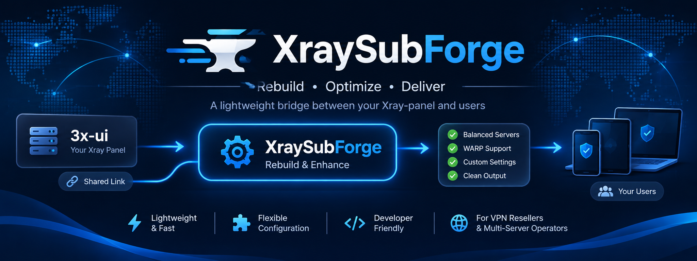
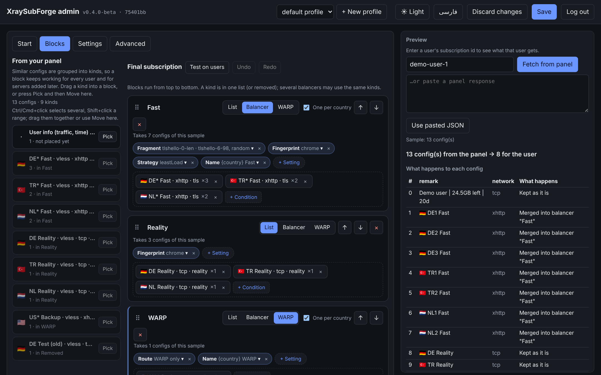
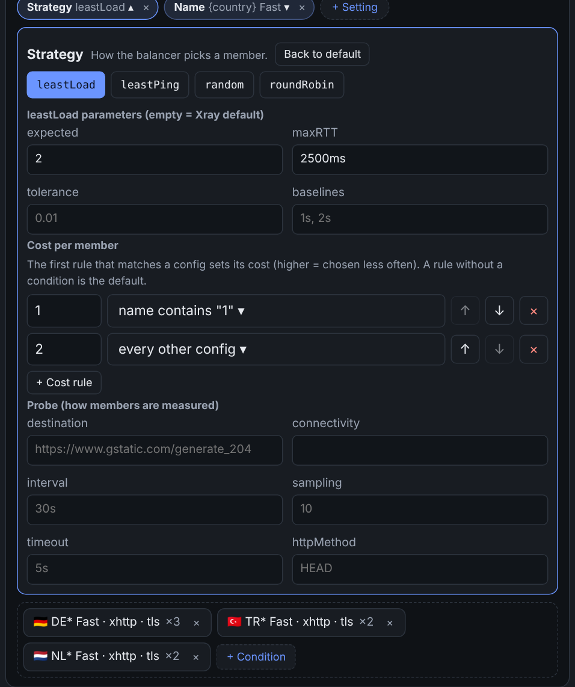
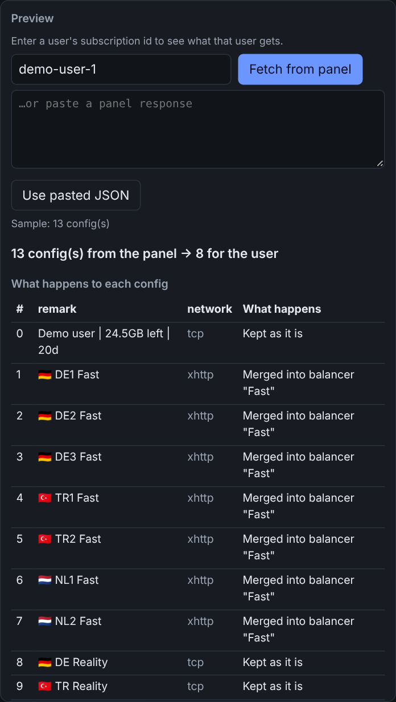

<div dir="rtl">

# XraySubForge

<p align="center"></p>

فارسی · [English](README.md) · **نسخهٔ 0.4.0-beta**

**یک ریورس‌پروکسی پیشرفته برای ساب Xray.** بین پنل 3x-ui شما (یا پنل‌های دیگر Xray-core) و برنامهٔ VPN کاربران قرار می‌گیرد. کاربر ساب خودش را از **دامنهٔ خودتان و با HTTPS** می‌گیرد؛ برای هر درخواست، XraySubForge از پنل می‌پرسد، **ساب را با قوانین و بلوک‌هایی که تعریف کرده‌اید بازسازی می‌کند** و نتیجه را به اپ می‌دهد. خود پنل می‌تواند روی localhost یا شبکهٔ خصوصی بماند و هرگز در معرض اینترنت نیست.

این ابزار *ساب* را پروکسی می‌کند، نه ترافیک VPN را: ترافیک کاربران هنوز مستقیم به سرورهای Xray شما می‌رود.

```
اپ VPN ──► XraySubForge (دامنهٔ شما، HTTPS) ──► پنل 3x-ui شما (ساب JSON)
                 │
                 └─ برای هر درخواست: قوانین، بالانسر، WARP، پچ  ──►  ساب بازسازی‌شده
```

بدون قانون یک ریورس‌پروکسی ساده است: ساب پنل بدون تغییر عبور می‌کند (حتی بایت‌به‌بایت، بخش [فقط ریورس‌پروکسی](#فقط-به‌عنوان-ریورس‌پروکسی) را ببینید). هر وقت خواستید قانون اضافه کنید، بدون اینکه لینک کسی عوض شود.

<p align="center"></p>

## چه کارهایی می‌کند

**بازسازی چیزی که کاربر می‌گیرد**

- **بلوک‌ها.** یک سازندهٔ کشیدن‌ورهاکردن برای ساب نهایی. کانفیگ‌های پنل به «گونه» (پروتکل، transport، امنیت، کشور و ...) دسته می‌شوند؛ یک گونه را داخل **فهرست**، **بالانسر**، بلوک **WARP** یا *حذف‌شده* بکشید. بلوک‌ها از بالا به پایین اجرا می‌شوند و صفحه نشان می‌دهد هر کدام چند کانفیگ می‌گیرد.
- **قوانین شرطی با regex.** حذف، نگه‌داشتن، چسباندن به بالا یا جابه‌جایی کانفیگ‌ها بر اساس اینکه چه *هستند*، نه فقط از کجا آمده‌اند. شرط‌ها با کلمه‌های ساده نوشته می‌شوند و می‌توانند regex هم داشته باشند.
- **بالانسر، یکی برای هر کشور.** همهٔ کانفیگ‌های یک کشور (یا هر الگوی دیگر) در یک کانفیگ بالانس‌شده ادغام می‌شوند: `leastLoad`، `leastPing`، `random` یا `roundRobin` در Xray، با همهٔ پارامترهای strategy و probe مربوطه به‌صورت فیلد فرم، **cost برای هر عضو** (ترجیح دادن بعضی سرورها)، ترتیب اعضا، قوانین مسیریابی اضافه برای بالانسر، چند عضو برای هر سرور (آدرس‌های مختلف)، و presetهای fragment و cipher-suite و fingerprint که هر عضو یکی را تصادفی برمی‌دارد.
- **WARP برای هر کاربر.** عبور یک کانفیگ از outbound خودتان (Cloudflare WARP روی MASQUE) با یک حساب WARP جدا برای هر کاربر، که می‌تواند در اولین درخواست کاربر خودکار ساخته شود. WARP می‌تواند پشت سرور خود کانفیگ باشد یا تنها، با یک outbound طعمهٔ اختیاری برای اپ‌هایی که یک کانفیگ MASQUE تنها را قبول نمی‌کنند.
- **پچ‌ها** برای هر تغییر دیگر در JSON (DNS، قوانین مسیریابی، mux، fragment، sockopt و ...): ادغام مقدار، یا اضافه کردن قانون مسیریابی قبل یا بعد از قوانین موجود.
- **تنظیماتی که می‌بینید.** فهرست داخلی دامنه‌های QUIC، قوانین پایهٔ مسیریابی، گزینه‌های sniffing و پورت‌های inboundهای جداشده در پنل نشان داده می‌شوند و قابل ویرایش‌اند. هیچ چیزی که روی خروجی اثر بگذارد داخل کد مخفی نیست.

**راحت اجرا کردن**

- **پیش‌نمایش و تست.** شناسهٔ ساب را وارد کنید، ساب واقعی آن کاربر را از پنل بگیرید و هنگام ویرایش ببینید هر کانفیگ چه می‌شود. *Test on users* چند شناسه را با هم بررسی می‌کند و تعداد کانفیگ ورودی و خروجی را می‌گوید.
- **چند سرویس در یک نصب (پروفایل).** هر پروفایل یک config کامل با پنل، بلوک‌ها و حساب‌های خودش است. درخواست بر اساس مسیر، نام هاست درخواست، یا اینکه کدام پنل شناسهٔ ساب را می‌شناسد به یک پروفایل می‌رسد. از پنل ادمین می‌توانید پروفایل را عوض، بسازید، تغییر نام بدهید یا حذف کنید.
- **پنل ادمین تحت وب** به فارسی (راست‌به‌چپ) و انگلیسی، با راهنمای مرحله‌به‌مرحله، undo/redo، خلاصهٔ تغییرات قبل از ذخیره و تم روشن و تیره. **منوی ترمینال** (`sforge`) همین کارها را از SSH انجام می‌دهد.
- **نصب‌کنندهٔ یک‌دستوری** با گواهی رایگان **Let's Encrypt**، چند دامنه با گواهی جدا برای هر کدام (SNI)، برداشتن خودکار تمدید، سرویس systemd و `sforge update`.
- **قالب‌های دیگر.** ساب raw و Clash هم از مسیرهای جدا عبور داده می‌شوند.

جای کارهایی را که خود 3x-ui انجام می‌دهد نمی‌گیرد. اگر **Hosts** و **Sub Balancers** خود پنل کافی است، این ابزار را لازم ندارید؛ برای قانون، الگو، منطق جدا برای هر کاربر یا یک «درِ ورودی» روی دامنهٔ خودتان سراغش بروید.

هیچ قرارداد نام‌گذاری و هیچ ارائه‌دهندهٔ خاصی را نمی‌شناسد. شما تعیین می‌کنید هر کانفیگ چیست، چی حذف شود و چی با چی ترکیب شود.

> با 3x-ui ساخته و امتحان شده. پنل‌های دیگری که JSON مخصوص Xray یا لینک‌های استاندارد می‌دهند (Marzban، Remnawave، ...) هم باید کار کنند: در آدرس پنل، جای شناسهٔ ساب `{id}` بگذارید. نتیجه را گزارش کنید.

> **نسخهٔ بتا (v0.4).** تست خودکار دارد و روی یک سرور واقعی استفاده شده، ولی هنوز کاربران زیادی ندارد. پروژه‌ای مستقل است و ارتباط رسمی با Xray و 3x-ui ندارد.

## بالانسر در چند کلیک

<p align="center"></p>

*Balancer* را بزنید، *One per country* را تیک بزنید، گونه‌های مورد نظر را داخلش بکشید و انتخاب کنید عضو را چطور برگزیند. پارامترهای خود strategy (برای `leastLoad`: `expected`، `maxRTT`، `tolerance`، `baselines`) و probe که اعضا را اندازه می‌گیرد داخل تنظیم **Strategy** هستند و پیش‌فرض Xray به‌صورت راهنما نشان داده می‌شود. costها ردیف‌اند: *این شرط این‌قدر cost دارد، بقیه آن‌قدر*. اگر به strategy دیگر بروید و برگردید، چیزی که نوشته بودید نمی‌پرد.

## پیش‌نمایش قبل از رسیدن به کاربر

<p align="center"></p>

پیش‌نمایش با جمله می‌گوید هر کانفیگ چه می‌شود (نگه‌داشته شد، در بالانسر ادغام شد، جابه‌جا شد، حذف شد) و کاربر قبل و بعد چند کانفیگ می‌گیرد. دکمهٔ ذخیره هم همین خلاصه را برای تغییرات شما نشان می‌دهد.

## نصب روی سرور (یک دستور)

روی یک سرور لینوکسی (Debian/Ubuntu؛ بقیه‌چیز خودکار نصب می‌شود)، با کاربر root:

```bash
curl -fsSL https://raw.githubusercontent.com/mjbe71/XraySubForge/main/install.sh | sudo bash
```

نصب‌کننده هر چه لازم دارد می‌پرسد و بقیه را خودش انجام می‌دهد. به ترتیب:

۱. **آدرس پنل.** اگر پنل 3x-ui روی همین سرور باشد، آدرس ساب JSON آن را پیشنهاد می‌دهد.
۲. **HTTPS.** دامنه‌ای که کاربران به آن وصل می‌شوند را بدهید. بعد به این ترتیب: گواهی خودتان اگر مسیرش را بدهید؛ وگرنه گواهی‌ای که از قبل روی سرور هست (مثلاً از 3x-ui)؛ وگرنه یک **گواهی رایگان Let's Encrypt** برای دامنه می‌گیرد (دامنه باید از قبل به همین سرور اشاره کند و پورت ۸۰ برای یک دقیقه آزاد باشد). گواهی‌ها بررسی می‌شوند (معتبر، منقضی‌نشده، کلید مطابق، دامنه پوشش داده‌شده) و تمدیدها خودکار برداشته می‌شوند. اگر در سؤال دامنه Enter بزنید، HTTPS رد می‌شود (فقط HTTP روی localhost).
۳. **پورت** و اینکه **پنل ادمین** (و رمزش) فعال شود یا نه.

بعد سرویسی می‌سازد که با بوت بالا می‌آید و لینک ساب شما را چاپ می‌کند. از آن به بعد:

```bash
sudo sforge help        # وضعیت، لاگ، ری‌استارت، به‌روزرسانی، tls (تغییر HTTPS)، set-admin-password و ...
sudo sforge update      # آخرین نسخه، با حفظ تنظیمات
sudo sforge add-domain --domain other.example.com   # گواهی رایگان Let's Encrypt برای یک دامنهٔ دیگر (server.domains)
```

اگر `sudo sforge` را بدون آرگومان اجرا کنید، یک **منوی تعاملی ترمینال** (به انگلیسی) باز می‌شود: وضعیت/لاگ/ری‌استارت/به‌روزرسانی سرویس، آدرس پنل، پورت و HTTPS، رمز ادمین، پروفایل‌ها، بلوک‌ها، قوانین، گروه‌ها، زنجیره‌ها و پچ‌ها با سؤال‌های راهنما (یا به‌صورت JSON در ویرایشگر شما)، پیش‌نمایش زنده برای یک شناسهٔ ساب و حساب‌های WARP. هر تغییر قبل از ذخیره اعتبارسنجی می‌شود.

همهٔ این‌ها را می‌شود برای نصب بدون سؤال به‌صورت گزینه هم داد (`--panel-url`، `--domain`، `--cert`/`--key`، `--letsencrypt`، `--port`، `--admin`، `--yes` و ...): `install.sh --help`. تنظیمات در `/etc/xraysubforge/config.json` و برنامه در `/opt/xraysubforge` است. حذف: `sudo sforge uninstall`. برای سرویس دوم روی همان سرور از `--service NAME` استفاده کنید.

> نصب‌کننده روی یک سرور واقعی تست شده. تشخیص 3x-ui اسم تنظیمات را از حافظه می‌خواند؛ اگر چیزی پیدا نکند فقط از شما می‌پرسد. مشکلات را گزارش کنید.

اگر مخزن را خودتان clone کرده‌اید و نصب‌کننده را نمی‌خواهید، `sudo bash install.sh link --service <نام سرویس systemd>` (داخل همان clone که باید `venv` داشته باشد) همین دستور `sforge` را برایش می‌سازد: منو، وضعیت، ری‌استارت، لاگ و `update` (git pull و ری‌استارت).

## نصب دستی

پایتون ۳.۹ به بالا (یا Docker) و پنل 3x-ui با **ساب JSON** فعال لازم است.

```bash
git clone https://github.com/mjbe71/XraySubForge && cd XraySubForge
python3 -m venv venv && . venv/bin/activate
pip install -r requirements.txt
cp config.example.json config.json       # آدرس ساب JSON پنل خودتان را در آن بگذارید
python app.py                            # سرور توسعه
```

آدرس `http://127.0.0.1:8080/sub/<شناسهٔ ساب کاربر>` را باز کنید: ساب پنل را می‌بینید (چون هنوز قانونی ندارید، بدون تغییر).

آدرس ساب JSON را از تنظیمات پنل خودتان پیدا کنید (در 3x-ui معمولاً مسیری مثل `/json/` هست؛ مال خودتان را چک کنید) و در `config.json` به‌عنوان `panel.url` بگذارید؛ شناسهٔ کاربر به انتهایش اضافه می‌شود.

### امتحان قوانین بدون شبکه

```bash
python -m xraysubforge preview examples/sample-panel.json examples/balancers.json
```

نشان می‌دهد هر کانفیگ یک پاسخ ذخیره‌شدهٔ پنل با قوانین `examples/balancers.json` چه می‌شود. با `python -m xraysubforge check config.json` یک فایل را اعتبارسنجی کنید.

### استفادهٔ واقعی

```bash
gunicorn app:app        # آدرس، پورت، worker و HTTPS (server.tls_cert / tls_key) از config.json خوانده می‌شود
```

یا Docker: `mkdir -p data && cp config.json data/ && docker compose up -d --build` (پورت سمت راست در `docker-compose.yml` باید با `server.port` یکی باشد). فایل‌های Docker هنوز توسط نویسنده تست نشده‌اند.

برای HTTPS یا `server.tls_cert` و `server.tls_key` را تنظیم کنید (کاری که نصب‌کننده می‌کند)، یا جلوی سرویس یک reverse proxy با HTTPS بگذارید و **لاگ دسترسی آن را خاموش کنید**، چون آدرس شامل شناسهٔ محرمانهٔ کاربر است (نمونهٔ nginx در README انگلیسی).

## پنل ادمین تحت وب

همه‌چیز را می‌شود به‌جای ویرایش دستی در مرورگر انجام داد. پنل **به‌طور پیش‌فرض خاموش است**؛ با گذاشتن رمز در `config.json` روشن می‌شود:

```bash
python -m xraysubforge hash-password        # رمز می‌پرسد و یک hash چاپ می‌کند
```

```json
{ "admin": { "password_hash": "<hash را اینجا بچسبانید>" } }
```

بعد `http://127.0.0.1:8080/admin` را باز کنید (مسیر: `admin.path`) و وارد شوید.

- **شروع** یک راهنمای مرحله‌به‌مرحله است که همه‌چیز را بررسی می‌کند (دسترسی به پنل، امتحان یک ساب، HTTPS، حساب‌ها، تنظیمات) و تنظیمات رایج را برایتان می‌سازد (پنهان کردن کانفیگ، بالانس، عبور از WARP).
- **بلوک‌ها** ویرایشگر اصلی است که بالاتر توضیح داده شد. هر بلوک تنظیمات خودش را دارد (*+ Setting*): presetهای fragment و cipher، fingerprint، strategy، address pool، نام، ترتیب اعضا و patch، قوانین catch-all، کپی برای هر سرور، ورودی WARP و بیشتر. تنظیماتی که داده‌ی ساختاریافته می‌خواهند فرم دارند (ردیف‌های *مسیر = مقدار*، کارت قانون)، نه کادر JSON.
- **تنظیمات** سرور، اتصال پنل، حساب‌ها و ثبت WARP و گزینه‌های خروجی را دارد.
- **پیشرفته** ویرایشگر JSON خام و مدیریت پروفایل را دارد. تب‌های قدیمی قوانین، گروه‌ها، WARP و پچ‌ها فقط وقتی دیده می‌شوند که چیزی داخلشان باشد؛ *Convert to block* چنین آیتمی را به بلوک می‌برد (آیتم قدیمی خاموش می‌شود، پاک نمی‌شود).

شرط‌ها با کلمه‌های ساده نوشته می‌شوند (یک فیلد مثل نام، یک نوع مثل «تمام می‌شود با» و یک یا چند کلمه)، با مقدارهایی که از ساب خودتان انتخاب می‌کنید و تعداد کانفیگ‌هایی که هر شرط رویشان می‌خورد؛ الگو (regex) فقط در بخش «پیشرفته» لازم است. **ذخیره**، `config.json` را می‌نویسد و قبلش نشان می‌دهد چه چیزی عوض می‌شود؛ تغییرات فوراً اعمال می‌شود.

فقط با HTTPS (یا از راه تونل SSH) استفاده کنید، چون رمز در درخواست ورود ارسال می‌شود. تنظیمات ورود (`admin.*`) فقط در `config.json` عوض می‌شوند، نه از داخل پنل.

## چند سرویس در یک نصب

`config.json` پروفایل پیش‌فرض است؛ هر فایل داخل `profiles/` کنار آن یک پروفایل دیگر است، با پنل، بلوک‌ها و حساب‌های خودش. یک دامنه می‌تواند چند پنل یا چند برند را سرو کند: درخواست به پروفایلی می‌رسد که مسیرش را دارد، یا `server.hosts` آن نام هاست درخواست را دارد، یا پنل آن شناسهٔ ساب را می‌شناسد. پروفایل‌ها هنگام شروع سرویس خوانده می‌شوند؛ پنل ادمین (و منوی ترمینال) می‌توانند آن‌ها را بسازند، تغییر نام بدهند و حذف کنند. جزئیات: [docs/config-reference.md](docs/config-reference.md#profiles-several-services-in-one-install).

## فقط به‌عنوان ریورس‌پروکسی

وقتی هیچ قانونی نباشد، ساب JSON بدون تغییر عبور می‌کند. می‌توانید یک قدم جلوتر بروید: `panel.mode` را `"proxy"` بگذارید (یا در صفحهٔ «شروع» پنل ادمین گزینهٔ «فقط ساب‌های پنل من را عبور بده» را انتخاب کنید) تا پاسخ پنل بایت‌به‌بایت به اپ برسد. اگر `panel.raw_url` و `panel.clash_url` را هم بگذارید، این دو فرمت هم از مسیرهای `/raw/<id>` و `/clash/<id>` عبور می‌کنند. کاربران ساب را از دامنهٔ خودتان و با HTTPS می‌گیرند، و خود پنل 3x-ui می‌تواند روی localhost یا شبکهٔ خصوصی بماند. هر وقت خواستید بدون عوض شدن لینک کسی، قانون اضافه کنید.

## تنظیمات

همه‌چیز در `config.json` است و تغییرات بدون ری‌استارت اعمال می‌شود. همهٔ گزینه‌ها در **[docs/config-reference.md](docs/config-reference.md)** (انگلیسی) و نمونه‌ها در `examples/`:

| می‌خواهید | استفاده کنید از |
|---|---|
| ساخت دیداری ساب نهایی | `blocks` (صفحهٔ بلوک‌ها) |
| حذف یا جابه‌جایی کانفیگ‌ها | `rules` |
| ادغام کانفیگ‌ها در یک بالانسر (به‌ازای هر کشور، پیشوند اسم و ...) | `groups` یا بلوک بالانسر |
| گذاشتن outbound خودتان (WARP، WireGuard و ...) جلوی یک کانفیگ خروجی | `chains` + `accounts` یا بلوک WARP |
| تغییر هر چیز دیگر (DNS، مسیریابی، mux، fragment و ...) | `patches` |
| سرو چند پنل یا برند از یک نصب | `profiles/` |
| تغییر آدرس، پورت، مسیر URL، timeout، دامنه‌ها | `server`، `panel` |

## نکات امنیتی

- شناسهٔ ساب قبل از ارسال به پنل بررسی می‌شود (`server.subid_regex`).
- مسیر عمومی ساب ورود و محدودیت نرخ ندارد (خود شناسهٔ ساب راز است). پورت را محلی نگه دارید و از reverse proxy استفاده کنید. پنل ادمین رمز، کوکی امضاشده، حفاظت CSRF و قفل پس از تلاش‌های ناموفق دارد.
- هرگز `config.json` یا فایل حساب‌ها را commit نکنید (در `.gitignore` هستند).
- سرویس هرگز شناسهٔ ساب یا آدرس پنل را لاگ نمی‌کند.

## تازه‌ها در 0.4.0-beta

- بلوک‌های بالانسر پارامترهایشان را داخل تنظیم Strategy دارند: پارامترهای `leastLoad`، probeهای `leastLoad` و `leastPing` و cost هر عضو. عوض کردن strategy دیگر چیزی را که نوشته‌اید پاک نمی‌کند.
- تنظیم‌هایی برای ترتیب اعضا، patch اعضا، قوانین catch-all، کپی برای هر سرور، حداقل اعضا، نگه‌داشتن کانفیگ‌های تکی، جایگاه، تغییرات ورودی WARP، choices، endpoints و patches. ویرایش‌های پیشرفته‌ای که تنظیم خودشان را دارند با *Move to settings* به آن‌جا می‌روند.
- در صفحهٔ بلوک‌ها چند کانفیگ را با هم انتخاب کنید (Ctrl/Cmd+کلیک، Shift+کلیک) و با هم جابه‌جا کنید.
- پروفایل‌ها، `sforge` به‌عنوان دستور کوتاه، `add-domain`، `link`، و نمایش و ویرایش پیش‌فرض‌های داخلی (دامنه‌های QUIC، قوانین پایه، sniffing).
- تب‌های قدیمی قوانین، گروه‌ها، WARP و پچ‌ها فقط وقتی چیزی داخلشان باشد دیده می‌شوند.

## هنوز نیست

ثبت خودکار حساب WARP برای هر کاربر (`accounts.register`، پیش‌فرض خاموش، با API غیررسمی Cloudflare که ممکن است بی‌خبر عوض شود؛ ثبت‌نام با API واقعی امتحان شده).

## پروژه‌های مشابه (بدون ارتباط)

Remnawave، Raven-subscribe، subscribe-middleware-go، Sub-Store.

## مجوز

Copyright (C) 2026 mjbe71. مجوز GNU Affero General Public License نسخهٔ ۳ یا بالاتر (AGPL-3.0-or-later)، فایل [LICENSE](LICENSE).
خلاصه: استفاده، تغییر و انتشار آزاد است، حتی تجاری؛ ولی اگر نسخهٔ تغییرداده را پخش کنید یا آن را به‌صورت سرویس شبکه در اختیار دیگران بگذارید، باید کد آن را با همین مجوز به آن‌ها بدهید.

</div>
