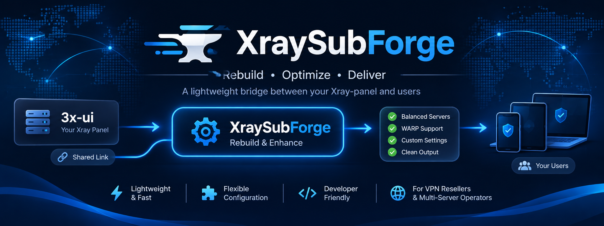
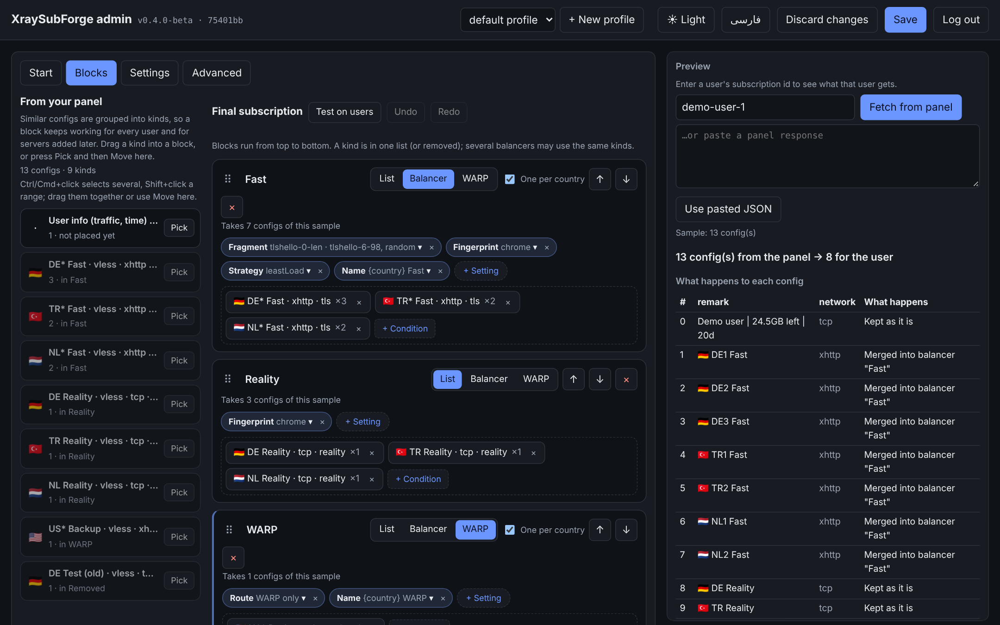
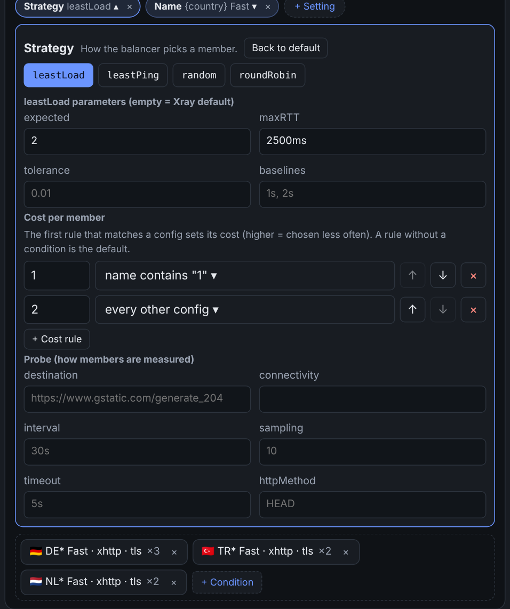
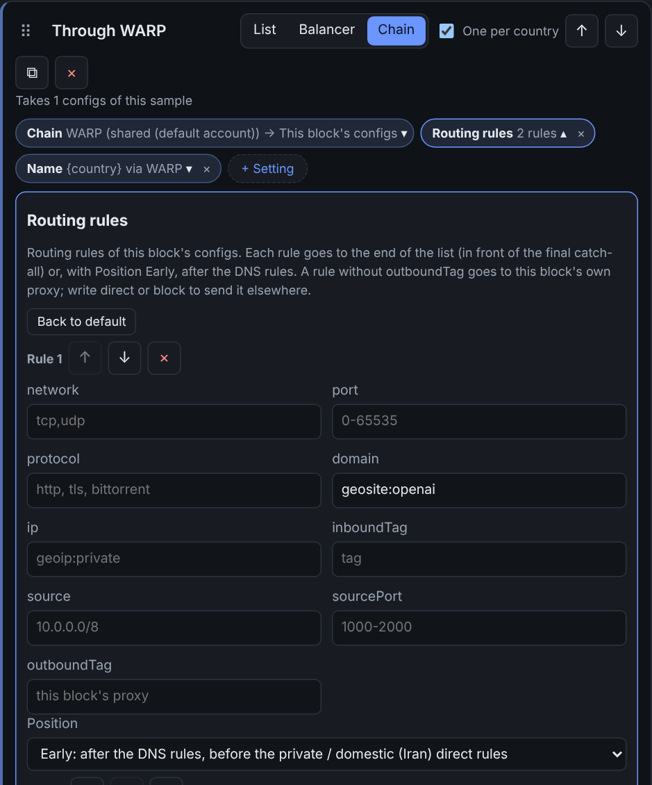
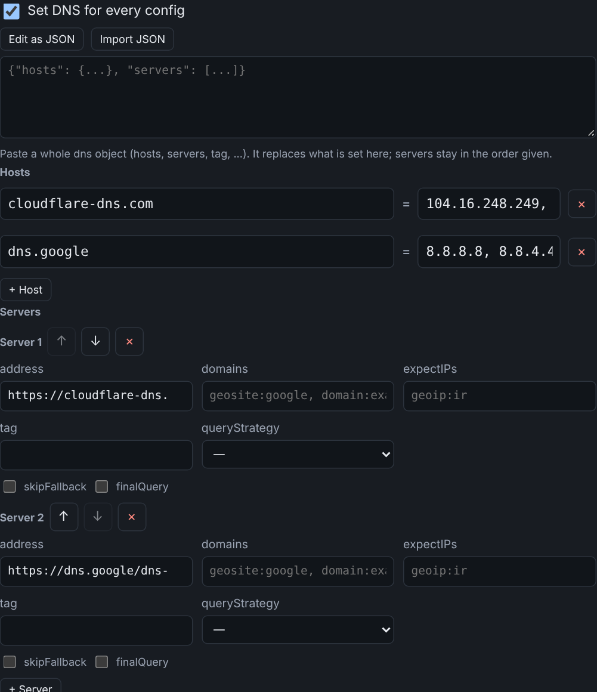
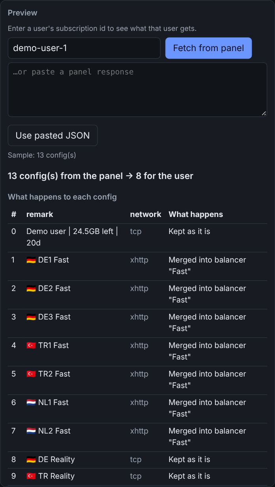

# XraySubForge

<p align="center"></p>

[فارسی](README.fa.md) · English · **v0.6.0**

**An advanced reverse proxy for Xray subscriptions.** It sits between your 3x-ui panel (or another Xray-core panel) and
your users' VPN apps. Users fetch their subscription from **your own domain, over HTTPS**; for every request
XraySubForge asks the panel, **rebuilds the subscription with the rules and blocks you defined**, and hands the result to
the app. The panel itself can stay on localhost or a private network and is never exposed.

It proxies the *subscription*, not the VPN traffic: your users' traffic still goes straight to your Xray servers.

```
VPN app ──► XraySubForge (your domain, HTTPS) ──► your 3x-ui panel (JSON subscription)
                 │
                 └─ per request: rules, balancers, WARP, patches  ──►  the rebuilt subscription
```

With no rules it is a plain reverse proxy: the panel's subscription passes through unchanged (even byte for byte, see
[Just a reverse proxy](#just-a-reverse-proxy)). Add rules whenever you like, without changing anyone's link.

<p align="center"></p>

## What it can do

**Reshape what users get**

- **Blocks.** A drag-and-drop builder for the final subscription. Configs from the panel are grouped into *kinds*
  (protocol, transport, security, country, ...); drag a kind into a **list**, a **balancer**, a **WARP** block, or *Removed*.
  Blocks run top to bottom and the page shows how many configs each one takes.
- **Conditional rules with regex.** Drop, keep, pin or reorder configs depending on what they *are*, not just where they
  came from. Conditions are written in plain words and can use regular expressions.
- **Balancers, one per country.** Merge all configs that share a country (or any other pattern) into one balanced config:
  Xray `leastLoad`, `leastPing`, `random` or `roundRobin`, with every strategy parameter and the matching probe as a form field,
  **costs per member** (prefer some servers), member order, extra routing rules for the balancer, several members per server
  (different addresses), and fragment / cipher-suite / fingerprint presets that each member picks at random.
- **Per-user WARP.** Route a config through an outbound of your own (Cloudflare WARP over MASQUE) with a separate WARP account for
  each user, optionally registered automatically on the user's first request. WARP can follow a config's own server or stand alone,
  with an optional decoy outbound for apps that refuse a lone MASQUE config.
- **Chains.** A chain block sends a config through up to four hops, client → hop 1 → hop 2 → the internet: WARP (personal or shared
  account), another config of the subscription, or an outbound imported from a `vless://`, `vmess://`, `trojan://` or `ss://` link with
  per-user placeholders. Outbound tags are plain (`proxy01`, `proxy02`, ...).
- **Routing rules per block.** List, WARP and chain blocks can carry their own routing rules, each placed at the end of the list
  (in front of the final catch-all, so it is never dead) or early (after the DNS rules, in front of the direct rules).
- **DNS.** Forms for your own DNS servers and hosts (edit as JSON, import a JSON), a dedicated DNS for the names your proxies connect to,
  and domestic DNS servers with a direct routing rule.
- **Account clean-up.** Optionally remove, once a day, the WARP accounts of users who were deleted from the panel (with safety guards).
- **Patches** for anything else in the JSON (DNS, routing rules, mux, fragment, sockopt, ...): merge values, or add routing rules
  before or after the existing ones.
- **Settings you can see.** The built-in QUIC domain list, the base routing rules, the sniffing options and the ports of the
  split inbounds are shown in the panel and can be edited. Nothing that changes the output is hidden in the code.

**Run it comfortably**

- **Preview and test.** Enter a subscription id, fetch that user's real subscription from the panel and watch what each config
  becomes while you edit. *Test on users* checks several ids at once and reports configs in and out.
- **Several services in one install (profiles).** Each profile is a complete config with its own panel, blocks and accounts. A
  request is routed to a profile by path, by the request's host name, or by which panel knows the subscription id. Switch,
  create, rename and delete profiles from the admin panel.
- **Web admin panel** in English and Persian (right-to-left), with a step-by-step setup guide, undo/redo, a summary of changes
  before you save, and light and dark themes. A **terminal menu** (`sforge`) does the same from SSH.
- **One-command installer** with free **Let's Encrypt** certificates, several domains with a certificate each (SNI),
  automatic renewal pick-up, a systemd service, and `sforge update`.
- **Other formats.** Raw links and Clash subscriptions can be passed through on their own paths.

It does not replace what 3x-ui already does. If the panel's own **Hosts** and **Sub Balancers** are enough for you, you do
not need this; use it for rules, patterns, per-user logic or a front door on your own domain.

It knows no naming scheme and no provider. You decide what each config is, what is removed and what is combined.

> Made and tested with 3x-ui. Other panels that give Xray JSON or standard links (Marzban, Remnawave, ...) should work too:
> put `{id}` in the panel address where the subscription id goes. Please report how it goes.

> **v0.5.** Covered by automated tests and in use on a real server, but not yet used by many people.
> An independent project, not affiliated with Xray or 3x-ui.

## A balancer in a few clicks

<p align="center"></p>

Pick *Balancer*, tick *One per country*, drop the kinds you want into it, and choose how it picks a member. The strategy's own
parameters (for `leastLoad`: `expected`, `maxRTT`, `tolerance`, `baselines`) and the probe that measures members live inside the
**Strategy** setting, each with Xray's default shown as a hint. Costs are rows: *this condition costs this much, everything else
costs that*. Switching to another strategy and back keeps what you typed.

## Chains, routing rules and DNS

<p align="center"> </p>

A **Chain** block sends each config through its hops (WARP, then the config, or any outbound you import from a link). Each block can add
its own **routing rules**; every rule is placed at the end of the list, in front of the final catch-all, or *early*, after the DNS
rules. DNS has forms (and *Edit as JSON* / *Import JSON*) under Settings.

## Preview before anything reaches a user

<p align="center"></p>

The preview explains in words what happens to each config (kept, merged into a balancer, moved, removed) and how many configs the
user gets before and after. Save shows the same summary for your changes.

## Install on a server (one command)

On a Linux server (Debian/Ubuntu: everything else is installed for you), as root:

```bash
curl -fsSL https://raw.githubusercontent.com/mjbe71/XraySubForge/main/install.sh | sudo bash
```

The installer asks what it needs and does the rest. In order:

1. **Panel address.** If a 3x-ui panel runs on the same server, it suggests the address of its JSON subscription.
2. **HTTPS.** Enter the domain users will connect to. Then, in this order:
   your own certificate files, if you give their paths; otherwise a certificate that already exists on the
   server (3x-ui's); otherwise it gets a **free Let's Encrypt certificate** for the domain (the domain must already
   point to this server, and port 80 must be free for a minute). Certificates are checked (valid, not expired,
   key matches, covers the domain) and renewals are picked up automatically. Press Enter at the domain question to
   skip HTTPS (plain HTTP on localhost only).
3. **Port**, and whether to enable the **web admin panel** (and its password).

Then it creates a service that starts at boot and prints your subscription link. Afterwards:

```bash
sudo sforge help        # status, logs, restart, update, tls (change HTTPS), set-admin-password, ...
sudo sforge update      # get the newest version, keeping your settings
sudo sforge add-domain --domain other.example.com   # free Let's Encrypt certificate for one more domain (server.domains)
```

Run `sudo sforge` with no arguments for an **interactive terminal menu** (English): service status/logs/restart/update, panel URL,
port and HTTPS, the admin password, profiles, blocks, rules, groups, chains and patches with guided questions (or as JSON in
your editor), a live preview for a subscription id, and WARP accounts. Every change is validated before it is written.

Everything can also be given as options for unattended installs (`--panel-url`, `--domain`, `--cert`/`--key`,
`--letsencrypt`, `--port`, `--admin`, `--yes`, ...): run `install.sh --help`. Settings live in
`/etc/xraysubforge/config.json`, the program in `/opt/xraysubforge`. To remove it: `sudo sforge uninstall`. For a second
service on the same server use `--service NAME`.

> The installer has been tested on a real server. The 3x-ui detection reads setting names from memory of 3x-ui; if it finds nothing, it just asks you.
> Please report problems.

If you cloned the repository yourself instead of using the installer, `sudo bash install.sh link --service <your systemd unit>` (run inside the clone, which needs its `venv`) creates the same `sforge` command for it: menu, status, restart, logs and `update` (git pull and restart).

## Manual install

You need Python 3.9+ (or Docker) and a 3x-ui panel with the **JSON subscription** enabled.

```bash
git clone https://github.com/mjbe71/XraySubForge && cd XraySubForge
python3 -m venv venv && . venv/bin/activate
pip install -r requirements.txt
cp config.example.json config.json       # then put your panel's JSON-subscription URL in it
python app.py                            # development server (see below for production)
```

Open `http://127.0.0.1:8080/sub/<a user's subscription id>`: you get the panel's subscription (unchanged, since there
are no rules yet).

**Your panel's URL.** Find the JSON-subscription address in your panel's settings (3x-ui usually offers a path
like `/json/`; check yours). Put it in `config.json` as `panel.url`; the user's id is appended to it.

### Try the rules without any network

```bash
python -m xraysubforge preview examples/sample-panel.json examples/balancers.json
```

prints what each config in a saved panel response becomes under `examples/balancers.json`.
`python -m xraysubforge check config.json` validates a file.

### Production

```bash
gunicorn app:app        # address, port, workers and HTTPS (server.tls_cert / tls_key) come from config.json
```

or Docker: `mkdir -p data && cp config.json data/ && docker compose up -d --build` (the right-hand port in
`docker-compose.yml` must match `server.port`). The Docker files are not yet tested by the author; please report problems.

For HTTPS either set `server.tls_cert` and `server.tls_key` (what the installer does) or put a reverse proxy
with HTTPS in front and **turn its access log off**: the URL contains each user's secret id.

```nginx
server {
    listen 443 ssl;
    server_name sub.example.com;
    # ssl_certificate ...;
    access_log off;
    location / {
        proxy_pass http://127.0.0.1:8080;
        proxy_set_header Host $host;
        proxy_set_header X-Forwarded-Proto $scheme;
    }
}
```

## Web admin panel

Everything can be edited in a browser instead of by hand. The panel is **off by default**; turn it on by
setting a password in `config.json`:

```bash
python -m xraysubforge hash-password        # asks for a password, prints a hash
```

```json
{ "admin": { "password_hash": "<paste the hash here>" } }
```

Then open `http://127.0.0.1:8080/admin` (path: `admin.path`) and log in.

- **Start** is a step-by-step guide that checks everything (is the panel reachable, does a test subscription work, HTTPS,
  accounts, settings) and can create common setups for you (hide configs, balance configs, route through WARP).
- **Blocks** is the main editor, described above. Each block has its own settings (*+ Setting*): fragment and cipher presets,
  fingerprint, strategy, address pool, names, member order and patches, catch-all rules, copies per server, WARP entry, and more.
  Settings that need structured data have forms (rows of *path = value*, rule cards), not JSON boxes.
- **Settings** holds the server, panel connection, accounts and WARP registration, and the output options.
- **Advanced** has the raw JSON editor and profile management. The older Rules, Groups, WARP and Patches tabs appear only while
  they hold something; *Convert to block* moves such an item into a block (the old one is switched off, not deleted).

Conditions are written in plain words (a field such as the name, a kind such as "ends with", and one or more words), with values
to pick from your own subscription and a count of how many of your configs each condition matches; patterns (regex) are only
needed under "Advanced". **Save** writes `config.json` and shows what changes first; changes apply at once.

Use it only over HTTPS (or through an SSH tunnel): the password travels in the login request. Login settings
(`admin.*`) can only be changed in `config.json`, never from the panel.

## Several services in one install

`config.json` is the default profile; every file in `profiles/` next to it is another one, with its own panel, blocks and
accounts. One domain can then serve several panels or brands: a request goes to the profile that owns its path, or whose
`server.hosts` holds its host name, or whose panel knows the subscription id. Profiles are read at startup; the admin panel
(and the terminal menu) can create, rename and delete them. Details: [docs/config-reference.md](docs/config-reference.md#profiles-several-services-in-one-install).

## Just a reverse proxy

With no rules, the JSON subscription passes through unchanged, and you can go one step further: set `panel.mode` to `"proxy"`
(or pick "Only forward my panel's subscriptions" in the admin panel's Start page) and the panel's reply is handed to the app
byte for byte. Set `panel.raw_url` and `panel.clash_url` and those two formats are forwarded as well, at `/raw/<id>` and
`/clash/<id>`. Your users get their subscriptions from your own domain, with HTTPS, while the 3x-ui panel itself can stay
on localhost or a private network. Add rules later without changing anyone's link.

## Configuring

Everything is in `config.json`, and changes apply without a restart. See **[docs/config-reference.md](docs/config-reference.md)**
for all options and `examples/` for ready examples:

| You want to | Use |
|---|---|
| build the final subscription visually | `blocks` (the Blocks page) |
| remove or reorder configs | `rules` |
| merge configs into one balancer (per country, per name prefix, ...) | `groups` or a balancer block |
| put your own outbound (WARP, WireGuard, ...) in front of an exit config | a chain block (a WARP hop, then your outbound) or `chains` |
| change anything else (DNS, routing, mux, fragment, ...) | `patches` |
| serve several panels or brands from one install | `profiles/` |
| change address, port, URL path, timeouts, domains | `server`, `panel` |

## Security notes

- The subscription id is checked (`server.subid_regex`) before it is sent to the panel.
- The public subscription route has no login and no rate limiting (the subscription id is the secret). Keep the port on localhost and use a reverse proxy. The admin panel has a password, signed session cookies, CSRF protection and a failed-login lockout.
- Never commit `config.json` or an accounts file (the `.gitignore` excludes them).
- The service never logs subscription ids or panel URLs.

## What is new in 0.6.0

- **Exits no longer come from the accounts file** (breaking). The older WARP block, the `exit_first` chain mode, the classic chain
  `exit` and the `account_exit` hop are gone: use a chain block with an *own outbound* hop, which can hold one outbound per flag.
  *Convert to a Chain block* in the admin panel moves an old WARP block over and copies its exits into the hop.
- **WARP endpoint pool** (`accounts.endpoints`) with a form in Settings.
- **Per-rule position** (end or early) also for the routing rules of balancer blocks.
- **Settings redesigned**: *Input* and *Output* cards (the addresses users get; raw links and Clash are switched on one by one),
  *Routing* split from *Inbounds & sniffing*, a short explanation for each routing option.
- `output.remark_rewrite` is removed: name configs with the *Name* setting of a block.

## What was new in 0.5.0

- **Chain blocks** (the WARP block grows into them): any config through WARP, another config of the subscription, or an imported
  outbound; several hops; plain outbound tags.
- **Routing rules for list, WARP and chain blocks**, with a per-rule position (end, or early); rules are added in front of a
  trailing catch-all rule so they are never dead; empty rule fields are dropped.
- **DNS forms**: your own `dns` (servers, hosts, `tag`, edit as JSON, import JSON), dedicated DNS with several servers, domestic DNS
  that really adds servers, the `dns` inbound tag in the form.
- **`accounts.prune`**: removes the WARP accounts of users the panel no longer has (`python -m xraysubforge prune-accounts --dry-run`
  to look first). Off by default.
- Personal or shared WARP account per block, selectable Xray values (fingerprint and others), duplicate a block, scrolling while dragging.
- Balancer *Catch-all rules* are now called *Routing rules*.

## What was new in 0.4.0-beta

- Balancer blocks take their parameters inside the Strategy setting: `leastLoad` parameters, the `leastLoad` and `leastPing`
  probes, and costs per member. Switching strategies no longer loses what you typed.
- Settings for member order, member patches, catch-all rules, copies per server, minimum members, keeping single configs,
  position, WARP entry changes, choices, endpoints and patches. Advanced edits that have a setting move there with
  *Move to settings*.
- Select several configs at once on the Blocks page (Ctrl/Cmd+click, Shift+click) and move them together.
- Profiles, `sforge` as the short command, `add-domain`, `link`, built-in defaults (QUIC domains, base rules, sniffing) shown and editable.
- The older Rules, Groups, WARP and Patches tabs show only while they hold something.

## Not included (yet)

Automatic per-user WARP account registration (`accounts.register`, off by default, uses Cloudflare's unofficial API, which can change without notice; registration has been tested against the real API).

## Similar projects (not affiliated)

Remnawave, Raven-subscribe, subscribe-middleware-go, Sub-Store.

## License

Copyright (C) 2026 mjbe71. GNU Affero General Public License v3.0 or later (AGPL-3.0-or-later), see [LICENSE](LICENSE).
In short: you may use, change and share it, also commercially; if you share a changed version, or let people use a changed version over a network, you must offer them its source under the same license.
